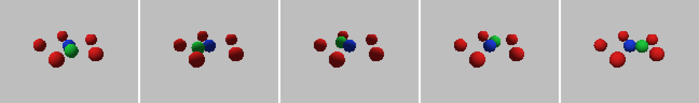
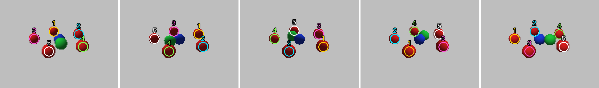
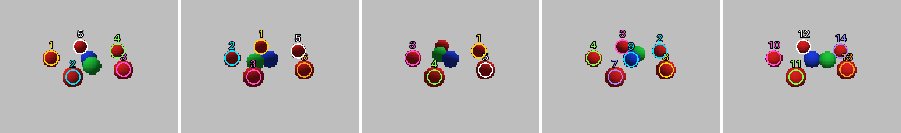

# CountOnce

[](https://github.com/shreev2703/countonce/actions/workflows/ci.yml)

Count objects in 3D from a few photos or a short video, without counting any object twice.

**Status: research prototype. It is not yet accurate on real photos.** On held-out orchard trees the
errors are large (table below), and the project's own "geometry beats simple baselines" gate was not
met. What has and has not been run is listed per component in [docs/STATUS.md](docs/STATUS.md).

**Live demo:** not hosted yet. To run the demo site locally, `cd web && npm ci && npm run dev`, then
open <http://localhost:3000/demo/tiny> (synthetic scene, CPU stand-in outputs).

## Example: five views, five red spheres

Input photos. This is a **synthetic test scene** rendered by
[`examples/tiny_scene/generate.py`](examples/tiny_scene/generate.py), with blue and green
distractors. The true count, **5**, is known by construction; there are no hand-counted real photos
yet.



**Predicted 5, true 5**, with the same ID on each sphere in every view. This run uses stand-ins (a
colour detector and the scene's known cameras and depth), so it shows that lifting and association
work when their inputs are good. It says nothing about model accuracy.



### Run it (CPU, no model weights)

```bash
pip install -e ".[dev]" && countonce run examples/tiny_scene --prompt "red sphere" --detector color_blob --backbone fixture --assoc v2 --config examples/tiny_scene/all_views.yaml --out results/tiny
```

It prints `red sphere: 5` and writes annotated views, `counts.csv` and `result.json` to
`results/tiny/`. Use a Python 3.11+ virtual environment.

## A representative failure

The same five views through the real models (GroundingDINO-tiny + VGGT-1B, v2): **predicted 14,
true 5**.



IDs change between views, so one sphere is counted several times; a blue distractor is counted (9);
and one partly hidden red sphere is missed in the third view. VGGT recovers poor cameras on this
small, flat-shaded, symmetric scene, so views of one sphere do not land close enough to merge
([root-cause notes](docs/DEVIATIONS.md)).

| Real models on this scene (v1 and v2, true count 5) | v1 | v2 |
|---|---|---|
| Default settings (near-duplicate filter keeps 1 of 5 views) | 7 | 7 |
| Detector threshold 0.5, per-frame NMS (1 view) | 5 | 5 |
| All 5 views, default threshold | 23 | 18 |
| All 5 views, threshold 0.5, per-frame NMS | 17 | 14 |

The one correct real-model result uses a single view and a threshold picked on this scene.
Measured 2026-11-25 on an RTX 5070 Laptop GPU (8 GB).

## Measured results on real trees (Fuji-SfM)

Mean absolute count error **in apples** (lower is better) with 95% bootstrap CIs over the 8 test
trees, by number of views `k`. Thresholds were frozen on training trees first.

| Method | k=3 | k=5 | k=10 | k=20 |
|---|---|---|---|---|
| CountOnce v1 | 61.6 [21.7, 110.1] | 67.2 [27.2, 114.8] | 52.6 [39.4, 69.9] | 100.0 [66.1, 130.1] |
| CountOnce v2 | 62.8 [22.4, 111.8] | 65.7 [25.1, 113.5] | 40.1 [28.0, 53.0] | 101.8 [68.2, 135.1] |
| Sum of per-photo counts | 61.0 [21.1, 108.9] | 68.2 [28.1, 115.6] | 68.2 [51.9, 88.9] | 157.4 [120.2, 203.1] |
| Max per-photo count | 66.2 [23.7, 118.8] | 60.1 [17.7, 110.4] | 31.1 [14.1, 50.2] | 153.8 [109.8, 187.3] |
| Median per-photo count | 72.6 [26.8, 127.4] | 57.9 [14.4, 111.5] | 43.8 [21.4, 67.3] | 185.0 [139.1, 219.5] |

- For scale, the mean true count per window is 77, 57, 53 and 197 apples at k = 3, 5, 10 and 20.
  Many short windows contain no ground-truth apple at all (7 of 16 at k=3, 8 of 16 at k=5).
- v1 and v2 beat both Sum and Max only at k=20. At k=10, Max is better than either.
- The detector is the largest error source, followed by duplicates from association.

Full tables, paired tests and caveats: [docs/RESULTS_FUJI.md](docs/RESULTS_FUJI.md). The runs were
made from a working tree with uncommitted changes. Fuji-SfM images are not shown here
(CC BY-NC-SA 4.0).

## Roadmap

Planned, **not done**. Details in [docs/PLAN.md](docs/PLAN.md).

1. Capture 20-30 real scenes, including scenes with none of the target, and hand-count them
   ([capture guide](docs/CAPTURE_GUIDE.md)).
2. Benchmark them with frozen splits, then fix the largest error source shown by the error
   decomposition.
3. Host the demo and the upload flow ([deploy notes](docs/DEPLOY.md)); show real scenes in the demo.
4. Evaluate the learned matcher (v3), so far tested on synthetic data only, on real data after
   training on rendered scenes.
5. Missing comparisons: CountVid and other video baselines, a vision-language model baseline,
   COLMAP and permutation sync on Fuji-SfM, calibrated (conformal) intervals on real data.
6. CountGD and CountGD++ detectors (currently stubs that exit with an error).
7. A small user pilot.

## How it works

```
photos / video
   │  ingest      drop blurry and near-duplicate frames, cap frame count
   ▼
open-vocabulary detector (per frame)      "apple" → boxes + scores        countonce/detect/
   │
   ▼
feed-forward reconstruction (VGGT)        cameras + depth + point maps    countonce/recon/
   │
   ▼
lift each detection to a 3D point + size  countonce/lift.py
   │
   ▼
associate detections across views         v1 3D clustering | v2 reprojection + Hungarian | sync
   │  (two detections in one photo are never the same object)
   ▼
count = number of instances, plus a sensitivity range, quality warnings,
overlays, counts.csv, scene.ply, result.json                              countonce/export/
```

A longer walk-through is in [docs/EXPLAINER.md](docs/EXPLAINER.md). The full plan is in
[docs/PLAN.md](docs/PLAN.md); deviations from it are logged in
[docs/DEVIATIONS.md](docs/DEVIATIONS.md).

## Limitations

- **Static scenes only.** Objects that move between photos break the geometry and are counted
  twice or missed. Moving-object detection is not implemented (`possibly_moving` stays at its default).
- **Chunk drift.** Captures larger than the backbone's frame budget are reconstructed in
  overlapping chunks and chained with Sim(3) alignment. Errors accumulate with the chunk count;
  there is no pose-graph optimization yet (see `docs/DEVIATIONS.md`).
- **Relative scale.** VGGT output has no real-world units. All thresholds are relative: merge
  distance is measured in object sizes, and scene scale is the median camera-to-scene distance.
- **The sensitivity range is not coverage.** The reported interval is the 10th–90th percentile of
  counts over a grid of merge strictness and detector thresholds. It shows how fragile the count
  is. It is not a statistical guarantee that the true count lies inside it
  (`confidence_method="sensitivity"`).
- Quality warnings and confidence scores are heuristics and are not calibrated.
- The default detector is HuggingFace GroundingDINO (text prompts only). CountGD and CountGD++ are
  planned, not implemented: selecting them exits with an error. Per-component evidence is in
  `docs/STATUS.md`, which wins if this README disagrees.

## Reproduce

Setup (Python ≥ 3.11; the reconstruction backbone needs a GPU):

```bash
python -m venv .venv && source .venv/bin/activate
pip install -e ".[dev,recon]"
countonce env --out results/env.json     # check Python / torch / CUDA / VRAM
```

Count objects in a folder of photos or a video:

```bash
countonce run --images path/to/photos --prompt "apple" --assoc v2 --out results/run1   # defaults: gdino + vggt
countonce run --video path/to/clip.mp4 --prompt "apple" --fps 2 --out results/run1
```

Or from Python (`import countonce` is light; torch loads only when `run` is first used):

```python
from pathlib import Path

import countonce

cfg = countonce.Config(out_dir="results/run1")
result = countonce.run(Path("path/to/photos"), "apple", cfg)  # -> countonce.CountResult
print(result.count, result.interval)
again = countonce.load_result("results/run1")  # reads results/run1/result.json
```

No GPU or weights? `examples/tiny_scene/` bundles five rendered views of five red spheres (plus
blue and green distractors) with known cameras and depth. The test-only `color_blob` detector and
`fixture` backbone count it on CPU (expected: 5):

```bash
countonce run examples/tiny_scene --prompt "red sphere" --detector color_blob --backbone fixture --assoc v2 --config examples/tiny_scene/all_views.yaml --out results/tiny
```

Without `--config`, the near-duplicate filter keeps one of the five views and the CLI warns about it.

The real-model failure above (GPU). On WSL2 with an 8 GB card the five-view run failed with
`CUDA driver error: device not ready` unless the allocator setting below was turned off:

```bash
PYTORCH_CUDA_ALLOC_CONF=expandable_segments:False countonce run examples/tiny_scene --prompt "red sphere" --assoc v2 --config configs/readme_real_failure.yaml --out results/tiny_real
```

The figures are drawn from those two runs by `python scripts/make_readme_figures.py --standin results/tiny --real results/tiny_real`.

These two backends exist only to exercise the CLI end to end (`tests/test_cli_e2e.py`); they are
not real detection or reconstruction. Regenerate the scene with `python examples/tiny_scene/generate.py`.

Flags: `--detector {gdino,color_blob}` (`countgd` and `countgdpp` are planned and exit with an error), `--backbone {vggt,vggt_omega,vggt_t3,colmap}`,
`--assoc {v1,v2,v3,sync}`, `--config file.yaml` (flags override the file). Not every choice has an
implementation yet; unimplemented ones exit with an error.

Download the Fuji-SfM dataset (about 6.9 GB). It is CC BY-NC-SA 4.0: research and education only, no commercial use. Do not redistribute its images or any GT derived from them, and do not upload them to a Hugging Face dataset. The loader reads `data/fuji_sfm` (gitignored):

```bash
scripts/download_fuji_sfm.sh data/raw/fuji_sfm
```

Run the benchmark. Scenes go in `data/scenes/<id>/{images/,gt.json}`:

```bash
countonce bench --config configs/bench.yaml --dry-run     # print the job grid size
countonce bench --config configs/bench.yaml               # run the sweep -> results/bench.csv
countonce bench --config configs/bench.yaml --figures results/figures
```

Tests and lint:

```bash
ruff check .
pytest -m "not slow and not gpu"
```

## Development

See [CONTRIBUTING.md](CONTRIBUTING.md) for setup, test markers and how to add a detector or baseline.

Install the git hooks once per clone (they are local to this repository, not global):

```bash
pip install pre-commit && pre-commit install
```

On commit they run ruff, `ruff format --check`, end-of-file / trailing-whitespace fixers and
`mypy countonce` (strict, a local hook that needs the dev extras). Run them on demand with
`pre-commit run --all-files`.

Schema compatibility fixtures live in `tests/fixtures/schemas/v<version>/`. After a
`schema_version` bump, add an upgrader and run `python scripts/regen_schema_fixture.py`; it writes
only the newest version's directory and refuses to overwrite an existing one.

## Credits, citations and licenses

This repo ships download scripts, not datasets or model weights. Verify each license before use.

| Item | Role | License status |
|---|---|---|
| VGGT (Wang et al., CVPR 2025) | Reconstruction backbone | Original checkpoint is non-commercial; a commercial variant exists by application |
| VGGT-Ω, VGG-T³ | Optional backbones (not wired) | Research only; license terms not verified |
| CountGD (Amini-Naieni et al.) | Open-vocabulary counting detector | MIT |
| CountVid, DG-Net | Video baselines (not run yet) | MIT (repository code; weights and datasets keep their own) |
| CountGD++, GroundingDINO, DINOv2 | Detector / appearance features | Not all verified; see `docs/MODEL_SURVEY.md` |
| Fuji-SfM | Benchmark scenes | CC BY-NC-SA 4.0 (research/education only): no redistribution of its images or derived GT, no HF dataset upload |
| WGISD, MinneApple, AppleGrowthVision, FSC-147 | Other candidate datasets | See `docs/DATASETS.md` |
| Kubric | Planned synthetic data | Open source; asset licenses to be checked |
| Pachauri et al., NeurIPS 2013 | Spectral permutation synchronization (`countonce/merge/sync.py`) | Paper |

Reconstruction wrapper, memory guard, frame extraction, COLMAP wrapper and plotting style are
ported from the author's VGGT benchmark repo (not public yet).

**License.** The code is Apache-2.0 ([LICENSE](LICENSE)). Model weights (for example VGGT, which is
non-commercial) and datasets are not covered by it and keep their own licenses.

Related work and the hypothesis under test: [docs/RELATED_WORK.md](docs/RELATED_WORK.md).
